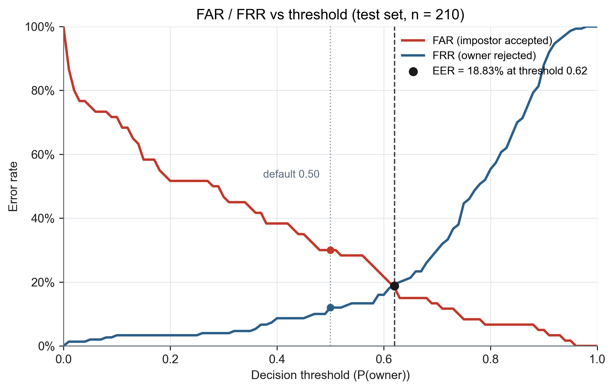
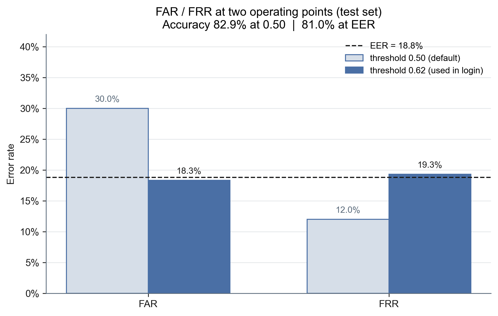

# Keystroke-GRU

ไอเดียหลัก: ไม่ได้ดูแค่รหัสผ่านถูกไหม แต่ดูว่า "พิมพ์จังหวะเหมือนเจ้าของไหม"
รหัสผ่านที่ใช้ `.tie5Roanl` + Enter (11 คีย์)
โมเดลเป็น GRU แยก Owner กับ Impostor

ฟีเจอร์ที่ดึงจากแต่ละครั้งที่พิมพ์
- Hold — กดค้างแต่ละปุ่มนานแค่ไหน (11)
- DD — ช่วงเวลาระหว่างกดปุ่มต่อปุ่ม (10)
- UD — ปล่อยปุ่มนึงถึงกดปุ่มถัดไป (10)
รวม 31 ค่า แล้ว reshape เป็น (11, 3) ก่อนเข้า GRU

## ตอนนี้

ทำครบสายแล้ว 

เก็บข้อมูล → รวม → normalize → แบ่ง train/val/test → เทรน → ประเมิน → มี login demo

คนที่เก็บข้อมูล: owner (เจ้าของ) + baitong, first, heng, peak+6คนที่กำลังจะมา(ออมมี่,ฝน,เอื้อ,จุบแจง,น่ำ,ซอ) (คนแอบอ้าง)
รวมประมาณ 1400 แถว (owner 1000, คนอื่นรวม 400) และ{อีก600ในอนาคต}
แบ่ง 70 / 15 / 15
ข้อมูล owner เยอะกว่าเยอะ เลยใส่ class_weight ตอนเทรน

ไฟล์สำคัญที่รันจริงได้
- collect_data.py — GUI เก็บจังหวะพิมพ์
- train.py — เทรน GRU ออกเป็น keystroke_gru_model.h5
- evaluate.py — ดู FAR FRR EER
- login.py — พิมพ์สด แล้วตัดสินว่าผ่านหรือไม่

## ตัวเลขที่ต้องจำ (test set)

ก่อนอื่นอธิบายคำศัพท์แป๊บ
- FAR = คนอื่นผ่าน (แย่ถ้าสูง)
- FRR = เจ้าของถูกตัด (ก็แย่ถ้าสูง *จะใส่มาทำไมวะ55555*)
- EER = จุดที่ FAR กับ FRR ใกล้กันที่สุด *จะดีมากเรย*

threshold 0.5 (ค่าเริ่มต้น) *เงื่อนไขขั้นตำการตัดสินใจ*
- FAR 0.30 → คนแอบอ้างผ่านประมาณ 30%
- FRR 0.12 → เจ้าของโดนตัดประมาณ 12%
- acc ประมาณ 83%

จุด EER (threshold ประมาณ 0.62) *อันนี้ที่ใช้ใน login ปัจจุบัน*
- EER ประมาณ 0.19 หรือราว ๆ 19%
- FAR ประมาณ 18%
- FRR ประมาณ 19%
- acc ประมาณ 81%

เทรน: epoch ที่ดีสุดประมาณรอบ 23, val_loss ต่ำสุดประมาณ 0.39
ตัวเลขพวกนี้อยู่ใน results_v2.txt

### รูปสำหรับบทคัดย่อ / สไลด์

**รูป 1 — จุดตัด EER** เส้นแดง FAR ลดลงเมื่อ threshold สูงขึ้น เส้นน้ำเงิน FRR เพิ่มขึ้น จุดดำคือ EER ≈ 18.8% ที่ threshold 0.62

**รูป 2 — เทียบจุดตัดสินใจ** ที่ 0.50 FAR สูง (30%) แต่เจ้าของโดนตัดน้อย (12%) ที่จุด EER ที่ใช้ใน login FAR เหลือ 18.3% แลกกับ FRR ขึ้นเป็น 19.3%

## Demo ที่โชว์ได้

รัน login.py
พิมพ์รหัส → โมเดลให้ค่าความน่าจะเป็นว่าเป็น owner
ถ้าต่ำกว่า 0.62 นับว่า fail
fail ติดกัน 3 ครั้ง ล็อกเครื่อง Windows
มีโหมด DRY_RUN ไว้ทดลองโดยไม่ล็อกจริง
log เก็บไว้ที่ data/login_log.csv

## ถ้าโดนถามต่อ / จุดอ่อนที่ควรยอมรับ

- ข้อมูลยังไม่สมดุล owner เยอะกว่า impostor มาก *แต่ผมจะไปเก็บให้ครบ10คนจ้า*
- EER ~19% พอโชว์แนวคิดได้ แต่ยังไม่ใช่ระดับใช้งานจริงจัง *มันerorบ่อยเกิน*
- ถ้าเก็บข้อมูลเพิ่ม คน/คีย์บอร์ด/วันเวลาที่ต่างกัน น่าจะช่วยได้ *แต่ตอนนี้คีย์บอร์ดเสื่อม*
- ถ้าอยากเน้นความปลอดภัยมากกว่า convenience ก็ขยับ threshold ให้ FAR ต่ำลงได้ แลกกับเจ้าของโดนตัดบ่อยขึ้น *ซึ่งถ้าจะใช้งานจริงน่าจะมีsettingให้ผู้ใช้เลือก*

## **จบแร้ววววววววววววววววววววววววววววววววววววววววววววววววววววววววววววววววววววววววววววว*